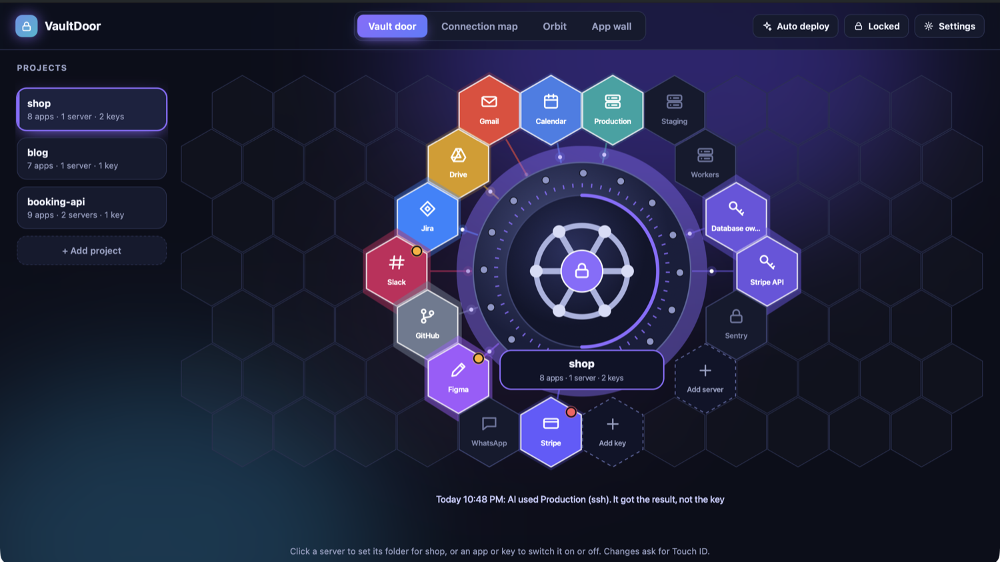
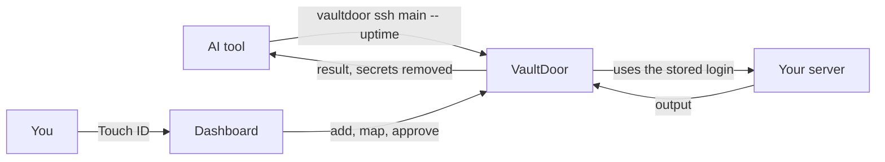
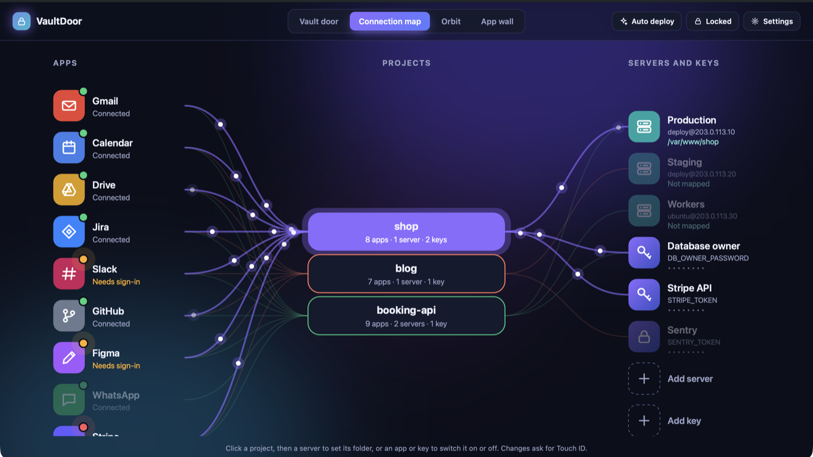
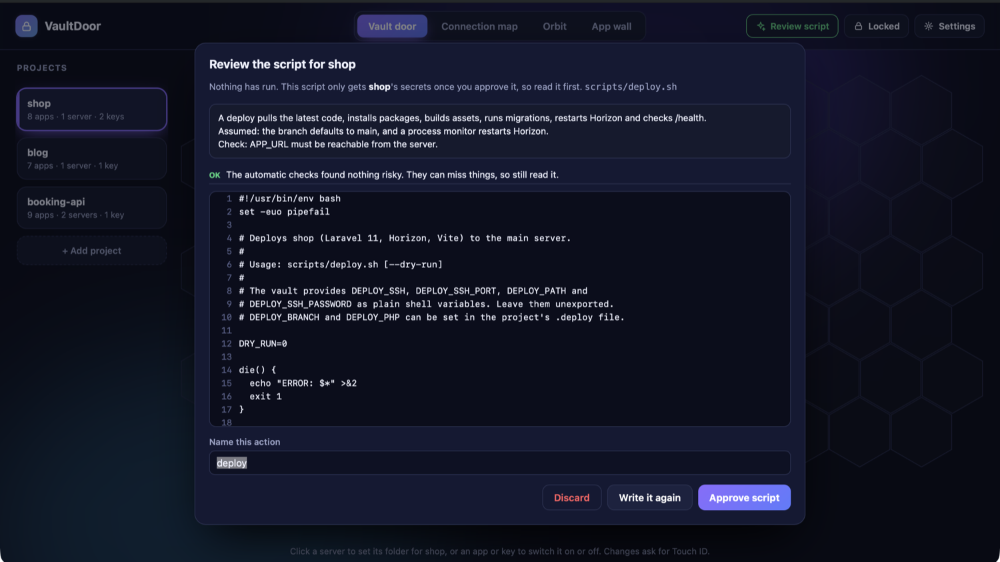

<div align="center">

# VaultDoor

**Let your AI use your passwords without seeing them.**

A skill for AI coding tools that keeps server logins and API keys in an encrypted vault on your Mac,<br>with a visual dashboard to control what each project can use.

[Install](#install) · [How it works](#how-it-works) · [Features](#features) · [Security](#security) · [Roadmap](#roadmap)



</div>

## Why

AI coding tools work best with real access: deploying, checking a server, calling an API. But anything your tool can read, the AI can read too, including `.env` files, deploy configs and SSH keys. Those values can end up in a chat log.

VaultDoor separates **using** a credential from **seeing** it. The AI asks to run something, VaultDoor supplies the secret, and the AI gets back the result with any secrets removed.



## Install

Tell your AI tool:

> Install the VaultDoor skill from github.com/Avnsh1111/vaultdoor and set it up for me.

The AI installs the skill, builds the app on your Mac and opens the dashboard. You then add your passwords in the dashboard, not in the chat.

Or install it yourself:

```bash
npx skills add Avnsh1111/vaultdoor -g -y
```

Then ask your AI tool to "set up VaultDoor". Without the skills command:

```bash
git clone https://github.com/Avnsh1111/vaultdoor
bash vaultdoor/scripts/setup.sh        # add --hook to let app switches block AI tool calls
```

**You need:**

- A Mac with macOS 13 or newer. [Windows and Linux are planned](#roadmap).
- Apple's command line tools: `xcode-select --install`
- For servers that log in with a password: `brew install sshpass`
- For Auto deploy and the connected apps list: an AI command-line tool that supports them. Today that's one specific tool, and **Copy prompt** gives you the same instructions for any other.

It's built on your Mac, so there's no unsigned download to approve. When macOS asks about the Keychain, enter your Mac password and choose **Always Allow**. This comes up once after each update.

Everyone gets their own private vault, and nothing you store is ever part of this repository.

## How it works

**1. Add your servers and keys.** A server holds its address and login: a password, a private key, or your Mac's own SSH setup. Passwords go into a secure macOS box and never pass through the page or the chat. One login used by five projects stays one server.

**2. Map them to projects.** Click a server, enter the folder, and that project can reach it. One server can map to several folders, such as your API and your website. Already have a `.deploy` file? **Move .deploy into the vault** does it all for you.



**3. Let the AI work.** The skill teaches your AI these commands:

```bash
vaultdoor status                           # what this project can use, by name only
vaultdoor ssh main -- php artisan about    # runs in the project's folder on the server
vaultdoor run deploy                       # runs a script you approved
vaultdoor http "API token" GET https://api.example.com/items
```

No command prints a stored value, adds a key or changes a setting. Every change needs your Touch ID in the dashboard.

## Features

**Auto deployment.** Click **Auto deploy**, optionally say what a deploy should do, and an AI studies the project and writes a script for its servers, with a `--dry-run` mode. It has no access to your vault while it works, and can change only that one file.



Nothing runs until you read and approve it. The review screen flags risky lines, such as printing a secret or `sshpass -p`, and reports syntax errors or any other file that changed. A deploy starts when you or your AI run it, not on every `git push`.

**Approved scripts stay approved.** Scripts are fingerprinted. If a script or its `.deploy` file changes, it stops running until you review and approve it again, so a script can't quietly be rewritten to expose a key.

**App control per project.** See every app connected to your AI, with its health, and switch each one on or off per project. With the hook installed, a switched-off app is really blocked.

**Activity.** See what was used and when.

**Move to a new Mac.** Export one encrypted file protected by a passphrase, then import it on the new Mac.

**Four ways to view it.** Vault door, connection map, orbit and app wall.

## Using it with your AI

Once it's set up, just talk normally:

- "Deploy this project."
- "Check why the queue is stuck on the server."
- "Is the latest migration on production?"

If something is missing, the AI says exactly what to do in the dashboard, for example: "Please map the Production server to this project with the folder `/var/www/app`."

The skill follows the open [Agent Skills](https://agentskills.io) format, so it works with AI tools that read skills. Setup links it into the ones it finds on your Mac. Tools without skill support can simply be told to read [`SKILL.md`](SKILL.md).

## Security

VaultDoor has **not had an independent security audit**. Please read this section, and report problems as described in [Reporting a vulnerability](#reporting-a-vulnerability).

### What protects your secrets

| Risk | Protection |
| --- | --- |
| The AI reads the stored file | Encrypted with AES-GCM. The key is in the macOS Keychain, readable only by this exact signed app |
| Another program asks the Keychain | macOS refuses or shows you a prompt |
| A program reads the vault's memory or loads code into it | Hardened runtime blocks debuggers and injected libraries |
| A secret shows up in output | Removed from output, including base64, hex and URL-encoded forms |
| A secret reaches other processes | Shell scripts get values as plain variables on a private pipe, not in the environment. SSH passwords go down a private pipe, and SSH keys into a private agent that can't hand them back |
| The AI edits a script to expose a key | Any change blocks the action until you approve it |
| The AI changes settings to run its own code | Actions start from a clean environment, so `BASH_ENV`, `PS4` and a changed `PATH` are dropped |
| A token goes to the wrong server | Tokens are sent only to hosts you allow, over HTTPS, and not across redirects to other hosts |
| The AI changes what a project can use | Settings are inside the encrypted vault and change only with Touch ID |
| The AI drives the dashboard from a browser | It is a native window, and there is no local server to reach |

### What it does not protect against

VaultDoor greatly reduces accidental exposure and casual reading. It is not a sandbox against a determined attacker, because the AI runs as the same macOS user as you. To close this fully, run the AI under a separate macOS account.

- **While an action runs, the script holds its secrets.** A script's own commands can expose them: `sshpass -p` shows a password in the process list, and a private key handed to a script sits in an owner-only file until the run ends. Non-shell scripts get values in the environment.
- **Code a script calls isn't fingerprinted,** such as a local `npm` or `composer` step. A script that passes secrets to such a step passes them to code the AI could have edited.
- **Output can be disguised.** Redaction catches known encodings, not a value a script deliberately scrambles.
- **`vaultdoor ssh` gives real access to the server.** Files there, such as a `.env`, can be read. A mapped folder is where commands start, not a limit on where they can go.
- **Your Mac's own SSH setup** relies on key files in `~/.ssh`, which the AI can read as you. Store the key in the vault to keep it out of reach.
- **Project matching uses the current folder.** It stops mistakes, not a tool that deliberately changes folder.
- **Apps signed in through your AI account** hold their own logins, so the dashboard can list them but not store them.
- **Only secrets you move are protected.** `.env` files, notes and old chat history can still contain values. Change any password that may already have been exposed.
- **The hook can be removed** by a tool that can edit its own settings, and it lets calls through until you answer the Keychain prompt after an update.

### Limits on the AI that writes deploy scripts

It runs without your saved AI settings or connected apps, has no shell or web access, gets no passwords or keys, can't open `.env`, `.deploy` or key files by name, can't read outside the project, and can write only the one script. `tests/lockdown.sh` attacks these limits with a real AI run.

Blocking works by file name, so a password in an ordinary-looking file can still be read. The automatic review checks can miss things too, so read each script yourself. **Copy prompt** doesn't carry these limits, because the other tool runs under its own settings.

### Reporting a vulnerability

Please use [GitHub's private vulnerability reporting](https://github.com/Avnsh1111/vaultdoor/security/advisories/new) rather than a public issue.

## Roadmap

- **macOS:** available now.
- **Linux:** planned. Its key stores let any program running as you read secrets, so it needs a different design, with the vault running under a separate user account.
- **Windows:** planned, with the same design change, after Linux.

## Development

```bash
scripts/build.sh --test     # the test build
tests/run.sh                # leak and tamper attacks, plus the real dashboard window
tests/setup_test.sh         # install, upgrade and uninstall, in throwaway home folders
tests/hardening.sh          # the real macOS protections, with a throwaway Keychain item
tests/lockdown.sh           # attacks the AI's limits with a real AI run, which uses some AI usage
```

Tests use fake values and throwaway vaults, and never touch your real one. Test commands are compiled only into the test build.

## Uninstall

```bash
bash ~/.agents/skills/vaultdoor/scripts/uninstall.sh           # keeps your stored vault
bash ~/.agents/skills/vaultdoor/scripts/uninstall.sh --purge   # also deletes it, after asking
```

## License

[MIT](LICENSE)
